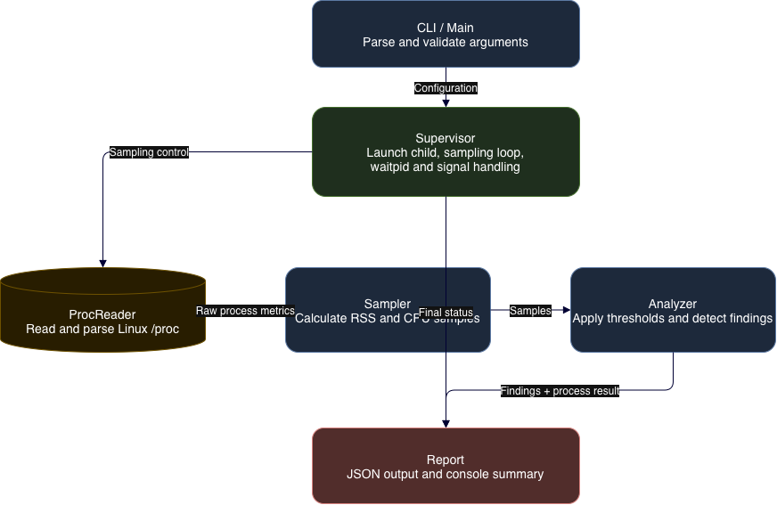

# procwatch – Requirements Specification

## 1.1 Purpose

This document defines the functional and non-functional requirements for `procwatch`.

`procwatch` is a lightweight command-line utility designed to monitor the runtime stability of a process on Linux. It observes selected resource-usage metrics, detects configurable stability conditions, and generates a report containing the monitoring results.

The purpose of this specification is to establish clear, testable expectations for the initial release (version 1).

## 1.2 Project Objectives

The initial release aims to:

- Monitor the resource usage of a directly launched child process.
- Detect significant memory growth.
- Identify sustained high CPU usage.
- Detect abnormal process termination.
- Generate a machine-readable JSON report.
- Provide predictable exit codes for automated workflows.

## 2. Functional Requirements (FA)

| ID | Requirement | Description |
|---|---|---|
| FA-01 | Process Launching | The application shall launch and monitor a single target process as a direct child process. |
| FA-02 | Resource Monitoring | The application shall periodically collect memory (RSS) and CPU usage information from the Linux `/proc` filesystem. |
| FA-03 | Stability Detection | The application shall detect significant memory growth and sustained high CPU usage based on configurable thresholds. |
| FA-04 | Process Termination | The application shall detect normal termination, non-zero exit statuses, and termination by signals. |
| FA-05 | Monitoring Report | The application shall generate a JSON report containing monitoring results, detected findings, and an overall verdict. |
| FA-06 | Command-Line Interface | The application shall provide configurable monitoring options, clear console output, and defined exit codes. |

## 3. Non-Functional Requirements (NFA)

| ID | Requirement | Description |
|---|---|---|
| NFA-01 | Platform Compatibility | The application shall run on Linux and use Linux-specific process monitoring interfaces. |
| NFA-02 | Resource Efficiency | The monitoring process shall introduce minimal CPU and memory overhead. |
| NFA-03 | Reliability | The application shall handle process termination and monitoring errors gracefully. |
| NFA-04 | Maintainability | The C++ implementation shall use a modular structure with clear responsibilities. |
| NFA-05 | Testability | The application shall provide C++ unit tests and Python component tests for its main functionality. |

## 4. System Architecture

The following diagram illustrates the planned internal architecture of `procwatch`.

